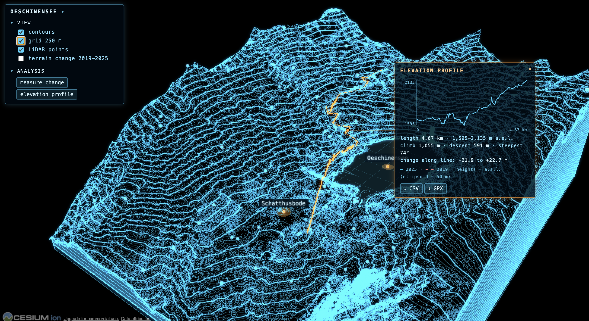

# Oeschinensee digital twin 🏔️



I turned Oeschinensee, an alpine lake above Kandersteg in Switzerland, into a glowing 3D "hologram" map in the browser, built entirely from free swisstopo data.

## Ever see avatar?

- **Show the valley as a 3D model.** A 5 × 4 km block of mountains with glowing contour lines and a grid, sitting on a floor like a 3D print.
- **Show the real laser scan.** Turn on the swisstopo LiDAR point cloud to see millions of glowing dots.
- **Spot how the mountains changed.** It compares the 2019 and 2025 elevation models: red where ground was lost, blue where it was gained. Across the whole area that's about 10 million m³ lost.
- **Measure any area you outline.** It tells you how many m³ of rock and ice disappeared there.
- **Draw an elevation profile.** Draw a line to get the climb, the steepest slope and how the ground changed along it, then download it as GPX for your watch.

Click a dot on the map to see its name.

## Built with

Python + GDAL/NumPy for the data, Cesium ion for hosting, and CesiumJS with a custom GLSL shader for the 3D view.

## Run it

```bash
python3 scripts/download_swisstopo.py                           # terrain, LiDAR, photos (~3 GB)
python3 scripts/download_swisstopo.py alti2m_2019 alti2m_2025   # the two years to compare
python3 scripts/fetch_vectors.py                                # lake outline, names, grid
python3 scripts/upload_ion.py                                   # needs CESIUM_ION_TOKEN in .env
conda run -n holocene python scripts/terrain_change.py          # needs GDAL + numpy

cp viewer/config.example.js viewer/config.js   # paste a read-only Cesium ion token
python3 -m http.server -d viewer 8000          # open http://localhost:8000
```

## Data

© swisstopo (swissALTI3D, swissSURFACE3D, SWISSIMAGE, swissTLM3D, swissNAMES3D), open data.
